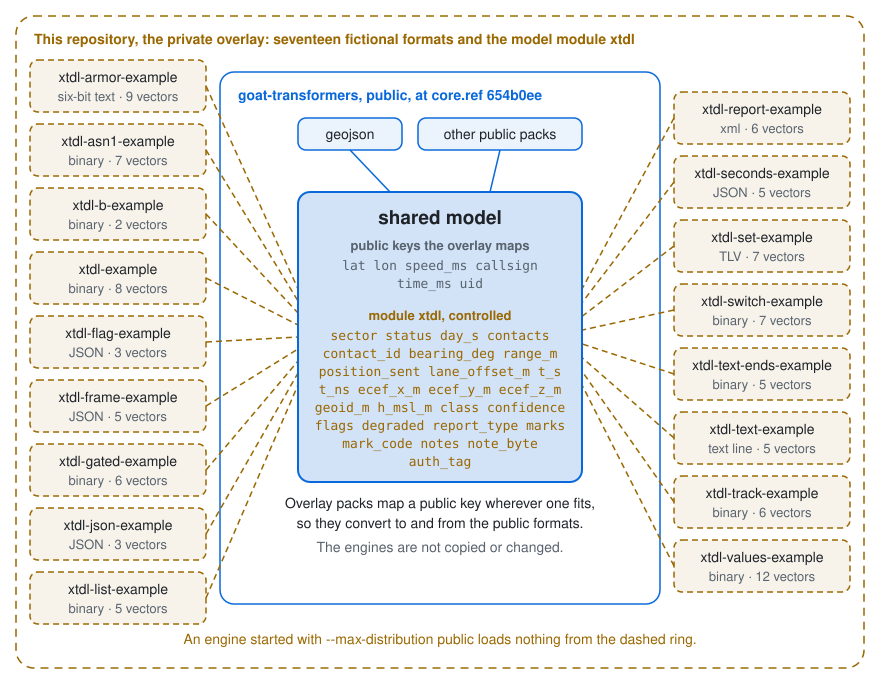

# goat-transformers-overlay-example

<picture>
  <source media="(prefers-color-scheme: dark)" srcset="docs/figures/overlay-ring-dark.svg">
  
</picture>

A worked example of an **overlay** for
[`goat-transformers`](https://github.com/USAREUR-AF/goat-transformers), the
library that converts messages between formats. Every format in this repository
is fictional. Copy the shape, put your own formats in it, and keep your copy
private.

## What an overlay is, and why

In `goat-transformers` a message format is a **pack**: a directory of data files
that an engine reads at start. The library's own repository is public, so it
holds only packs written from specifications that may be published.

Some formats have specifications that cannot be published. A pack written from
such a specification restates its field layout, so the pack cannot be published
either. An overlay is where those packs live: a separate, private repository
that holds only the packs and the model keys they need, and names the commit of
the public library it builds with. The engines are never copied or changed.
They read the overlay's packs the same way they read the public ones.

## The layering

```
  goat-transformers, public            engines, specification, public packs
  (the commit named in core.ref)       and public model modules
                 +
  the overlay, private                 model/   modules for keys only its formats have
  (this repository shows the shape)    packs/   its formats, with their vectors
                 =
  an assembled tree                    built by ./assemble.sh, never committed:
                                       the engines run public and overlay formats
```

A change to an engine is a new commit in the library and a new `core.ref` here.
A change to a format is a commit in the overlay. Nothing moves from the overlay
into the library.

## What the overlay owns

| Path | Holds |
|---|---|
| `core.ref` | the commit of `goat-transformers` the overlay builds with |
| `model/<module>.def` | model modules for keys and lists that only the overlay's formats have, marked `distribution controlled` |
| `packs/<format>/pack.def` | one format: its wire, its fields and rules, marked `distribution controlled`, with a `source` line |
| `packs/<format>/pack.md` | the layout in words |
| `packs/<format>/vectors/` | conformance vectors: an input message and the exact expected output |
| `tool-vectors/` | runs of the engine's command-line tool (engine-spec 0.23) on the overlay's formats: arguments, exit status and the exact output |
| `tool-vectors-json-only/` | the same, for an engine built with only the `json` and `geojson` wires (engine-spec 0.24) |
| `bench/overlay-set.json` | the benchmark set of engine-spec 0.25 for the overlay's formats: one vector of each pack, run by the engine's benchmark |
| `tools/vectors.py` | computes the expected bytes of the vectors, and the expected output of the tool vectors, without an engine |
| `assemble.sh` | builds the assembled tree; refuses to replace a library file |
| `check.sh` | assembles, runs the Rust engine's tests and the tool vectors, and shows that a public-only engine refuses the overlay |
| `PROVENANCE.md` | the rights basis and handling of the packs (a template here) |

The `distribution` line is what the engines enforce:

- A `public` pack may use only `public` model modules. So a key that exists only
  in an overlay format is declared in an overlay module, and no public pack can
  map it.
- A `controlled` pack may use `public` and `controlled` modules. So an overlay
  format converts to and from every public format through the public keys.
- An engine started with `--max-distribution public` loads nothing marked
  `controlled` and stops with `distribution-refused`.

## The example formats

Six invented formats and one invented model module. They are marked
`distribution controlled` only to show the mechanics.

| File | What it is | What it shows |
|---|---|---|
| `model/xtdl.def` | module `xtdl`: seventeen keys, the list `contacts` with three item keys | a `list`; a `derive` line that fills `xtdl.day_s` (time of day) from the public key `time_ms`; a `present` derive that sets `xtdl.position_sent` (engine-spec 0.12); `xtdl.lane_offset_m` for the `smag` field of xtdl-values-example; the 0.16 derive lines of xtdl-frame-example (time, ECEF, height above mean sea level); the 0.18 flag tokens of xtdl-report-example |
| `packs/xtdl-example/` | binary, two message layouts | message kinds chosen by a number on the wire (`kind`, `when`, `requires`); a value table (`map`, `via`); a `default`; a `const`; a counted list (`group ... count`) |
| `packs/xtdl-b-example/` | binary, other byte order, other status numbers, other time step | the same keys in a different layout; a second value table for the same key |
| `packs/xtdl-json-example/` | JSON | the same list as a JSON array (`group`); the full time in `time_ms` |
| `packs/xtdl-track-example/` | binary | no-value codes on the wire (`absent`, engine-spec 0.9): a field holding its code leaves the key absent, and a key the entity lacks is written as the code; a scaled field rounds half away from zero and refuses a value that does not fit (engine-spec 0.11) |
| `packs/xtdl-text-example/` | text line with `$` and a checksum | the `text` wire (engine-spec 0.10): comma-separated fields, degrees and minutes (`dm`), a time of day (`hms`), an NMEA-style checksum |
| `packs/xtdl-flag-example/` | JSON | a flag set from whether a value is sent (`derive ... present`, engine-spec 0.12), with a `default` for "not sent" |
| `packs/xtdl-set-example/` | TLV | a keyed set of tag, length and value items with a nested set, residue and a 16-bit checksum item (the `tlv` wire, engine-spec 0.13) |
| `packs/xtdl-armor-example/` | six-bit armored text | a `bits` message read and written as printable text, six bits a character (`armor sixbit`), a call sign in six-bit characters (`sixbit`), an optional last field (engine-spec 0.14) |
| `packs/xtdl-values-example/` | binary | the value transforms (engine-spec 0.15): octal digits, sign and magnitude (with an `absent` code, and plain `smag`), an integer scale that rounds (microseconds to `time_ms`), a 6-bit character set and a scaled IEEE float; GeoJSON both ways |
| `packs/xtdl-frame-example/` | JSON | the derive functions (engine-spec 0.16): a time as seconds and nanoseconds, a position as earth-centered, earth-fixed coordinates, and a height above mean sea level from a geoid separation, all through `derive` lines in `model/xtdl.def` |
| `packs/xtdl-gated-example/` | binary | gate blocks on a fixed layout (engine-spec 0.17): a position that exists only when a validity bit after it is set, and bits whose meaning a mode bit chooses (a sector or a lane offset) |
| `packs/xtdl-report-example/` | XML | conditional output (engine-spec 0.18): a confidence written only with a class (`with`), flag tokens built and read by derive lines (`tokens`, `has_token`), a time without a zero fraction (`iso8601_short`), and an element written even when empty (`element`) |
| `packs/xtdl-asn1-example/` | ASN.1 unaligned PER | a message defined in ASN.1 (engine-spec 0.19): constrained integers, an ENUMERATED, an OPTIONAL string, a CHOICE, a SEQUENCE OF and an extension marker, each taking the fewest bits its constraint allows |
| `packs/xtdl-switch-example/` | binary, sequential | a later part laid out by a value read earlier (engine-spec 0.20 `switch`), with one case for two values and an `else` |
| `packs/xtdl-list-example/` | binary, sequential | the list forms of engine-spec 0.21: a count read before other fields (`count` and `group ... count @`), a list closed by a last-item flag (`last`) and a list to the end of the message (`rest`) |
| `packs/xtdl-text-ends-example/` | binary, sequential | long and terminated fields of engine-spec 0.22: a 96-bit tag kept as hex (`hex`), a fixed text field that ends at a NUL (`stop 0`), and a 7-bit call sign of any length ended by code 127 (`until:127`) |

Each `pack.md` states the layout, and the two binary ones work an example byte
by byte.

### What carries between formats

`geojson` is a public pack of the library; it maps only keys of the public
`core` module.

| From | To | Carries | Does not carry | Why |
|---|---|---|---|---|
| `xtdl-example` position | `geojson` | latitude, longitude | sector, status, time of day | both packs map the public keys `lat` and `lon`; a public pack cannot use the `xtdl` module |
| `geojson` | `xtdl-example` position | latitude, longitude; time of day when the GeoJSON holds `time_ms` | sector (written 0); status (written `unknown`) | `derive` fills `xtdl.day_s` from `time_ms`; `default` supplies the status; the pack's `requires lat lon` selects the position layout |
| `xtdl-example` position | `xtdl-b-example`, and back | latitude, longitude, sector, status, time of day | nothing | both packs map the same `core` and `xtdl` keys; each pack's value table turns its own status number into the model's word |
| `xtdl-example` contacts | `xtdl-json-example` | sector, the list of contacts with every item key | time of day | both packs map the list `xtdl.contacts`; the JSON format holds a full time, which a time of day cannot supply |
| `xtdl-json-example` with contacts | `xtdl-example` contacts | sector, the list of contacts, time of day | `id`, status, position | the list selects the contacts layout (`requires xtdl.contacts`), and the count byte is written from the number of items; `derive` fills the time of day from `time` |
| `xtdl-example` contacts | `geojson` | nothing | sector, time of day, the list | the list is declared in the `xtdl` module, which no public pack can use |

A list crossing formats, from the vectors:

```
xtdl-example:       3a 100e00 02 0c400f c8a078
xtdl-json-example:  {"sector":7,"contacts":[{"id":12,"bearing_deg":90,"range_m":1500},{"id":200,"bearing_deg":225,"range_m":12000}]}
```

Byte 4 (`02`) is the count. Each following group of 3 bytes is one item of the
list, and one object of the JSON array.

## Try it

You need `git`, `bash`, `python3` and a Rust toolchain (`cargo`).

`core.ref` in this repository is the commit of `goat-transformers` the example
was checked with. To run everything in one step:

```bash
./check.sh
```

It ends with `check: ok` after showing the engine's test results and the
refusal by a public-only engine. With a local checkout of the library, use that
instead of fetching:

```bash
./check.sh --core-dir /path/to/goat-transformers
```

To assemble a tree and work in it:

```bash
./assemble.sh /tmp/assembled
cd /tmp/assembled/engines/rust

# every vector of the library and of the overlay
cargo test

# the formats the engine loaded, the sixteen overlay formats among them:
# format, version and wire, separated by tabs
cargo run -q -- list-formats

# what carries between two overlay formats, one line per ordered pair
cargo run -q -- matrix --packs-only xtdl-example,xtdl-json-example

# a contact message to JSON
echo 3a100e00020c400fc8a078 | cargo run -q -- convert --from xtdl-example --to xtdl-json-example

# a public format into an overlay format
echo '{"type":"Feature","geometry":{"type":"Point","coordinates":[10.5,35.25]},"properties":{"time_ms":1614456000000}}' \
  | cargo run -q -- convert --from geojson --to xtdl-example

# a public-only engine refuses the overlay: exits 1 with `distribution-refused`
cargo run -q -- list-formats --max-distribution public

# an engine with only the wires you need (engine-spec 0.24): the json overlay
# format loads, a bits one is `unknown-wire`
cargo run -q --no-default-features --features json,geojson -- list-formats --packs-only xtdl-json-example
cargo run -q --no-default-features --features json,geojson -- list-formats --packs-only xtdl-example

# the benchmark (engine-spec 0.25) on the overlay's set, from the tree root;
# with the path of this repository's bench/overlay-set.json
cd /tmp/assembled && cargo run --release -q --manifest-path engines/rust/Cargo.toml --example bench -- /path/to/overlay/bench/overlay-set.json
```

The assembled tree holds a file `.goat-transformers-assembled` with the library
commit it was built from. Do not commit an assembled tree: it mixes the public
library with the overlay.

## Start your own overlay

1. Create a **private** repository. Give access only to the people who may hold
   the specifications the packs are written from.
2. Copy `assemble.sh`, `check.sh`, `core.ref`, `.gitignore`, `PROVENANCE.md` and
   `.github/workflows/check.yml` into it. Leave out this example's `model/`,
   `packs/` and `tools/`.
3. Write the commit of `goat-transformers` you build with into `core.ref`.
4. Fill in `PROVENANCE.md`: the rights basis and the handling of the content.
5. For each format, write `packs/<format>/pack.def` with
   `distribution controlled` and a `source` line that names the document it was
   written from. The pack language is in the library's `spec/engine-spec.md`.
6. Map a value to a key of the public modules (`model/` in the library)
   wherever one fits: those values convert to and from every public format.
   Declare the rest in your own module, `model/<module>.def`, marked
   `distribution controlled`.
7. Write vectors under `packs/<format>/vectors/`. Take the expected bytes from
   the specification or from a recorded message, never from an engine's output.
8. In `check.sh`, replace the sixteen format names and the GeoJSON conversion
   with your own formats, and write your own `tool-vectors/` (the format is in
   the library's `spec/vector-format.md`, Tool vectors). Run `./check.sh` until it ends with `check: ok`.
9. Run every deployment that may hold only public formats with
   `--max-distribution public`.
10. Never copy a pack, a module, a vector or an assembled tree from the overlay
    into a public repository.

## License

Apache-2.0 (`LICENSE`, `NOTICE`). An overlay you build from this shape carries
the terms its own content requires.
